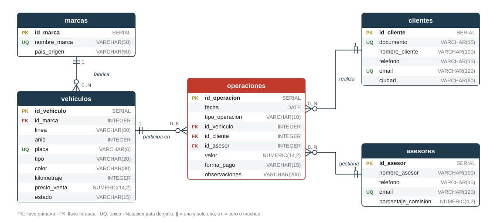
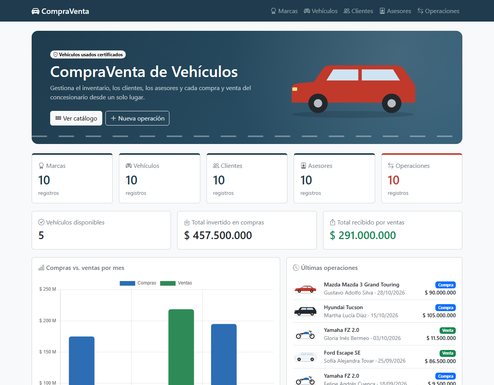
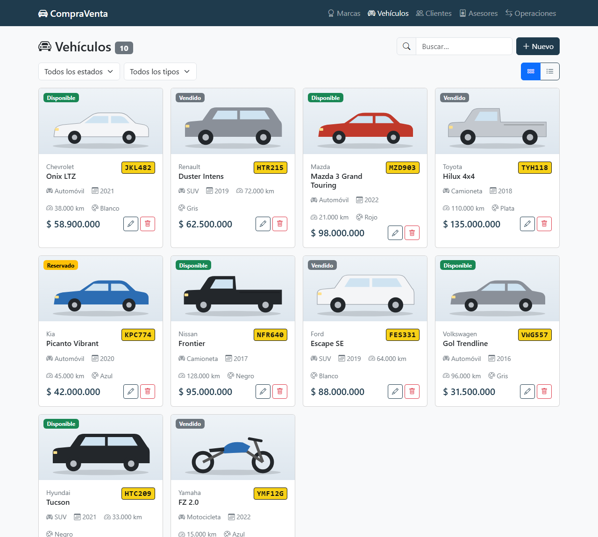
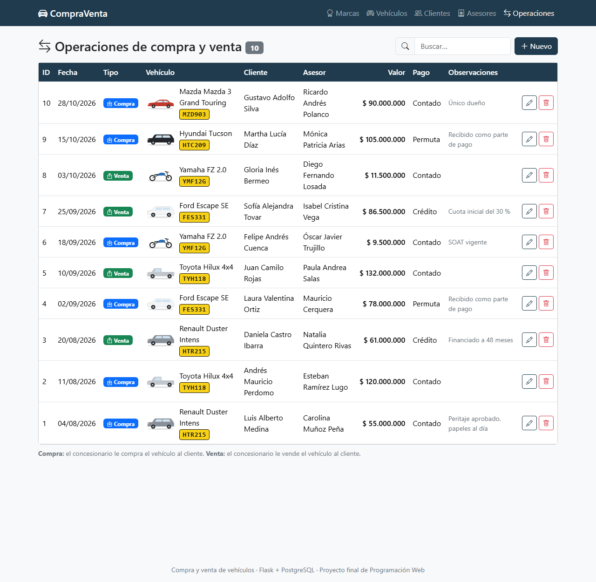
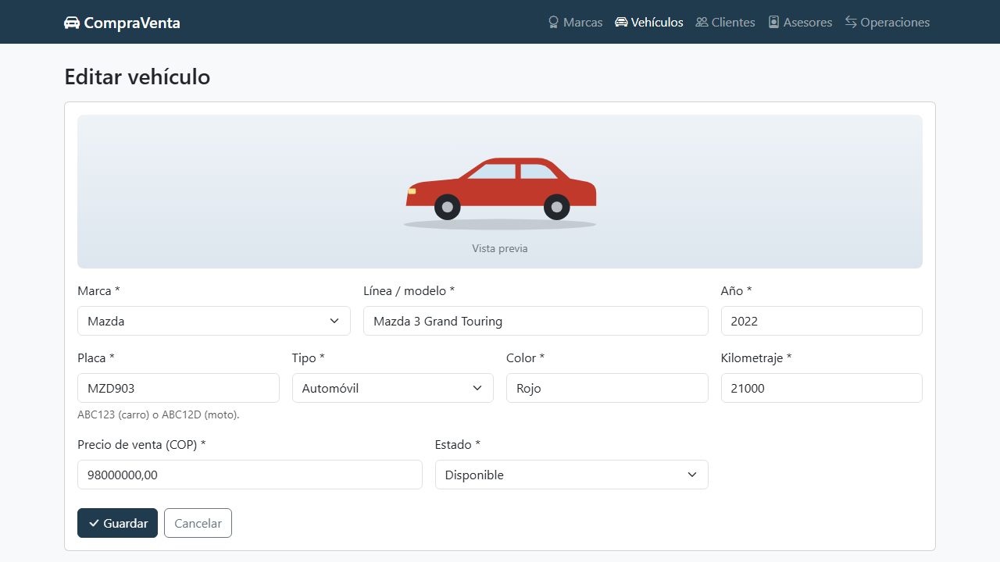

# CompraVenta de Vehículos · Flask + PostgreSQL

Proyecto final de **Programación Web**. Aplicación web para gestionar un concesionario de
vehículos usados: su inventario, los clientes, los asesores y las **operaciones de compra y
venta**. Permite crear, consultar, editar y eliminar (CRUD) los registros de las cinco tablas.

## Integrantes

- Samuel Ramos Acuña
- Mario Hernán García Perdomo

## Descripción del tema

El concesionario **compra** vehículos usados a sus clientes y luego los **vende** a otros
clientes. Cada negocio queda registrado como una *operación*, que indica el vehículo, el
cliente, el asesor que la atendió, el valor acordado y la forma de pago.

| Tabla | Qué guarda |
|---|---|
| `marcas` | Fabricantes de vehículos (Chevrolet, Mazda, Toyota…) |
| `vehiculos` | Inventario: marca, línea, año, placa, tipo, kilometraje, precio y estado |
| `clientes` | Personas que le venden o le compran vehículos al concesionario |
| `asesores` | Empleados que atienden las operaciones y su porcentaje de comisión |
| `operaciones` | Cada compra o venta. Tiene **3 llaves foráneas**: vehículo, cliente y asesor |

## Modelo entidad-relación



La justificación de la normalización (3FN) y el diccionario de datos están en
[docs/modelo_datos.md](docs/modelo_datos.md). El plan de pruebas está en
[docs/plan_pruebas.md](docs/plan_pruebas.md).

## Tecnologías

Python 3.10+, Flask 3, psycopg2, PostgreSQL, Jinja2, Bootstrap 5 (desde CDN), pytest.

## Estructura

```
compraventa_vehiculos/
├── app.py               # Punto de entrada: crea la app y registra los blueprints
├── config.py            # Lee la configuración del archivo .env
├── db.py                # Conexión a PostgreSQL, query / execute y mensajes de error
├── validators.py        # Validaciones de los formularios en el servidor
├── routes/              # Un blueprint (CRUD) por tabla
│   ├── marcas.py
│   ├── vehiculos.py
│   ├── clientes.py
│   ├── asesores.py
│   └── operaciones.py
├── templates/
│   ├── base.html        # Plantilla común (herencia): menú, mensajes, Bootstrap
│   ├── _macros.html     # Botones y encabezados reutilizables
│   ├── index.html       # Panel de inicio
│   └── <tabla>/list.html, <tabla>/form.html
├── static/css/styles.css
├── database/
│   ├── 01_creacion.sql  # Creación de las 5 tablas (PK, FK, CHECK, UNIQUE)
│   ├── 02_datos.sql     # 10 registros por tabla
│   └── backup.sql       # Backup completo generado con pg_dump
├── docs/                # MER, diccionario de datos, plan de pruebas y evidencias
├── tests/test_crud.py   # 36 pruebas automáticas con pytest
├── requirements.txt
├── requirements-dev.txt # requirements.txt + pytest
├── .env.example
└── .gitignore
```

## Instalación (Windows)

Requisitos: Python 3.10 o superior, PostgreSQL con pgAdmin 4 y Git.

1. Clonar el repositorio y entrar a la carpeta:
   ```powershell
   git clone https://github.com/USUARIO/compraventa_vehiculos.git
   cd compraventa_vehiculos
   ```
2. Crear y activar el entorno virtual e instalar las librerías:
   ```powershell
   py -m venv .venv
   .venv\Scripts\activate
   pip install -r requirements-dev.txt
   ```
   > Si PowerShell no deja activar el entorno, ejecuta una vez
   > `Set-ExecutionPolicy -Scope CurrentUser RemoteSigned`.
3. Crear la base de datos. En pgAdmin: clic derecho en *Databases* → *Create* → *Database…*
   con el nombre `compraventa_db`. Luego, sobre la base, abre *Query Tool*, carga el archivo
   `database/backup.sql` y ejecútalo (F5).
   También se puede hacer desde la terminal:
   ```powershell
   psql -U postgres -c "CREATE DATABASE compraventa_db"
   psql -U postgres -d compraventa_db -f database/backup.sql
   ```
4. Copiar `.env.example` como `.env` y poner la contraseña de PostgreSQL:
   ```powershell
   copy .env.example .env
   ```
   ```
   DB_HOST=localhost
   DB_PORT=5432
   DB_NAME=compraventa_db
   DB_USER=postgres
   DB_PASSWORD=tu_contraseña
   ```

## Ejecutar

```powershell
.venv\Scripts\activate
python app.py
```

Abrir **http://127.0.0.1:5000**

## Pruebas automáticas

```powershell
python -m pytest -v
```

Las pruebas usan la base real: cada una crea sus propios registros (con el prefijo `ZZ_TEST_`)
y los elimina al terminar, así que los datos originales no cambian.

## Funcionalidades

| Tabla | El listado muestra | El formulario |
|---|---|---|
| marcas | número de vehículos de cada marca | nombre (único) y país |
| vehiculos | nombre de la marca, placa, km, precio y estado con color | marca en lista desplegable, validación de placa y año |
| clientes | cuántos vehículos le vendió y le compró al concesionario | documento (único, solo números), email (único) |
| asesores | operaciones, total negociado y comisión ganada | comisión entre 0 y 10 % |
| operaciones | vehículo, placa, cliente y asesor (con `JOIN`) | vehículo, cliente y asesor en listas desplegables; propone el precio en una venta |

Detalles técnicos:

- **Consultas parametrizadas** (`%s` / `%(nombre)s`) en todas las sentencias, para evitar la
  inyección SQL.
- **Validación en el servidor** (`validators.py`) con mensajes claros antes de tocar la base.
- **Integridad referencial**: las llaves foráneas son `ON DELETE RESTRICT`. Si se intenta
  eliminar, por ejemplo, un cliente con operaciones, la app muestra un mensaje en vez de fallar.
- **Errores de la base** (duplicados, CHECK, FK, NOT NULL) traducidos a español en `db.py`.
- Eliminar siempre usa **POST** y pide confirmación.

Interfaz:

- **Ilustraciones de los vehículos** dibujadas en SVG (`templates/_vehiculo.html`): cambian según
  el tipo (automóvil, SUV, camioneta, moto) y se pintan con el color registrado. No usan imágenes
  externas, así que funcionan sin internet.
- **Catálogo de vehículos en tarjetas** con filtros por estado y tipo, y botón para cambiar a vista
  de tabla.
- **Buscador** en todos los listados (`static/js/app.js`): filtra en el navegador sin recargar.
- **Panel de inicio** con contadores animados, gráfico de compras vs. ventas por mes (Chart.js)
  y las últimas operaciones.
- **Vista previa en vivo** del vehículo en el formulario al elegir el tipo y escribir el color.

## Capturas

| Inicio | Vehículos |
|---|---|
|  |  |

| Operaciones | Formulario con vista previa |
|---|---|
|  |  |
