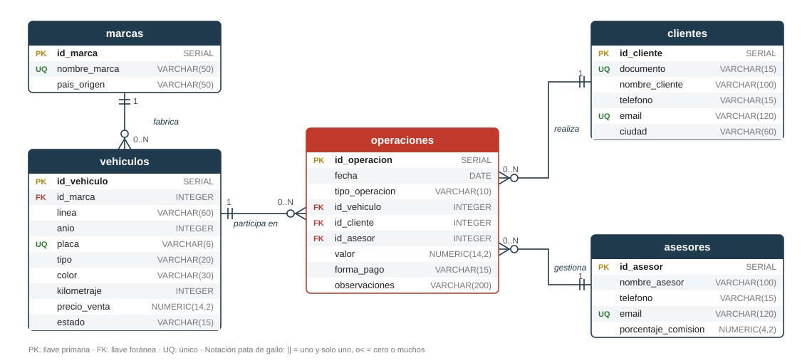

# Modelo de datos · compraventa_db

## 1. Diagrama entidad-relación (MER)

| Relación | Cardinalidad | Lectura |
|---|---|---|
| marcas → vehiculos | 1 : N | Una marca fabrica cero o muchos vehículos; cada vehículo es de una sola marca. |
| vehiculos → operaciones | 1 : N | Un vehículo puede aparecer en varias operaciones (se compra y luego se vende); cada operación es sobre un solo vehículo. |
| clientes → operaciones | 1 : N | Un cliente puede hacer varias operaciones; cada operación tiene un solo cliente. |
| asesores → operaciones | 1 : N | Un asesor gestiona varias operaciones; cada operación la atiende un solo asesor. |

La tabla **operaciones** tiene **tres llaves foráneas** (`id_vehiculo`, `id_cliente`, `id_asesor`).
Cada operación es una **Compra** (el concesionario le compra el vehículo a un cliente) o una
**Venta** (el concesionario le vende el vehículo a un cliente).

Todas las llaves foráneas usan `ON DELETE RESTRICT` (no se puede borrar un registro que tiene
datos relacionados) y `ON UPDATE CASCADE`.

---

## 2. Justificación de la normalización

### Primera forma normal (1FN)
Todas las tablas tienen una llave primaria (`SERIAL`), cada columna guarda **un solo valor
atómico** y no hay grupos repetidos. Por ejemplo, un vehículo no guarda una lista de sus
operaciones: cada operación es una fila aparte de la tabla `operaciones`. El cliente tiene un
solo teléfono y un solo email por columna.

### Segunda forma normal (2FN)
Las cinco tablas tienen una **llave primaria simple** (una sola columna). Por eso no puede
haber dependencias parciales: todos los atributos dependen de la llave completa. Cumplen 2FN
porque cumplen 1FN.

### Tercera forma normal (3FN)
No hay **dependencias transitivas** (un atributo que no es llave y que depende de otro atributo
que tampoco es llave):

| Tabla | Por qué cumple 3FN |
|---|---|
| marcas | `nombre_marca` y `pais_origen` dependen solo de `id_marca`. |
| vehiculos | El nombre y el país de la marca **no** se repiten en cada vehículo: solo se guarda `id_marca` (FK). Línea, año, placa, color, kilometraje, precio y estado describen al vehículo y dependen solo de `id_vehiculo`. |
| clientes | Documento, nombre, teléfono, email y ciudad dependen solo de `id_cliente`. |
| asesores | Nombre, teléfono, email y porcentaje de comisión dependen solo de `id_asesor`. |
| operaciones | Solo guarda las FK del vehículo, el cliente y el asesor; sus nombres se obtienen con `JOIN`. El `valor` **no** se copia del `precio_venta` del vehículo, porque es el precio negociado en esa operación (puede ser distinto y queda como histórico). La **comisión** del asesor no se guarda: se calcula (`valor × porcentaje_comision`) para no tener un dato derivado que pueda quedar inconsistente. |

---

## 3. Diccionario de datos

### marcas
| Campo | Tipo | Restricciones | Descripción |
|---|---|---|---|
| id_marca | SERIAL | PK | Identificador de la marca |
| nombre_marca | VARCHAR(50) | NOT NULL, UNIQUE | Nombre del fabricante (Chevrolet, Mazda…) |
| pais_origen | VARCHAR(50) | NOT NULL | País de origen de la marca |

### vehiculos
| Campo | Tipo | Restricciones | Descripción |
|---|---|---|---|
| id_vehiculo | SERIAL | PK | Identificador del vehículo |
| id_marca | INTEGER | FK → marcas, NOT NULL | Marca del vehículo |
| linea | VARCHAR(60) | NOT NULL | Línea o modelo (Onix LTZ, Hilux 4x4…) |
| anio | INTEGER | NOT NULL, CHECK (1980 a 2027) | Año del modelo |
| placa | VARCHAR(6) | NOT NULL, UNIQUE, CHECK (formato ABC123 o ABC12D) | Placa colombiana |
| tipo | VARCHAR(20) | NOT NULL, CHECK (Automóvil, SUV, Camioneta, Motocicleta) | Tipo de vehículo |
| color | VARCHAR(30) | NOT NULL | Color |
| kilometraje | INTEGER | NOT NULL, DEFAULT 0, CHECK (≥ 0) | Kilómetros recorridos |
| precio_venta | NUMERIC(14,2) | NOT NULL, CHECK (> 0) | Precio al que el concesionario ofrece el vehículo (COP) |
| estado | VARCHAR(15) | NOT NULL, DEFAULT 'Disponible', CHECK (Disponible, Reservado, Vendido) | Estado en el inventario |

### clientes
| Campo | Tipo | Restricciones | Descripción |
|---|---|---|---|
| id_cliente | SERIAL | PK | Identificador del cliente |
| documento | VARCHAR(15) | NOT NULL, UNIQUE, CHECK (6 a 15 dígitos) | Número de documento de identidad |
| nombre_cliente | VARCHAR(100) | NOT NULL | Nombre completo |
| telefono | VARCHAR(15) | NOT NULL | Teléfono de contacto |
| email | VARCHAR(120) | UNIQUE (opcional) | Correo electrónico |
| ciudad | VARCHAR(60) | NOT NULL | Ciudad de residencia |

### asesores
| Campo | Tipo | Restricciones | Descripción |
|---|---|---|---|
| id_asesor | SERIAL | PK | Identificador del asesor |
| nombre_asesor | VARCHAR(100) | NOT NULL | Nombre completo |
| telefono | VARCHAR(15) | NOT NULL | Teléfono de contacto |
| email | VARCHAR(120) | NOT NULL, UNIQUE | Correo corporativo |
| porcentaje_comision | NUMERIC(4,2) | NOT NULL, DEFAULT 0, CHECK (0 a 10) | Porcentaje de comisión por operación (1.50 = 1,5 %) |

### operaciones
| Campo | Tipo | Restricciones | Descripción |
|---|---|---|---|
| id_operacion | SERIAL | PK | Identificador de la operación |
| fecha | DATE | NOT NULL | Fecha de la operación |
| tipo_operacion | VARCHAR(10) | NOT NULL, CHECK (Compra, Venta) | Compra: el concesionario adquiere el vehículo. Venta: lo vende |
| id_vehiculo | INTEGER | FK → vehiculos, NOT NULL | Vehículo negociado |
| id_cliente | INTEGER | FK → clientes, NOT NULL | Cliente que vende o compra |
| id_asesor | INTEGER | FK → asesores, NOT NULL | Asesor que atendió la operación |
| valor | NUMERIC(14,2) | NOT NULL, CHECK (> 0) | Valor acordado (COP) |
| forma_pago | VARCHAR(15) | NOT NULL, CHECK (Contado, Crédito, Permuta) | Forma de pago |
| observaciones | VARCHAR(200) | (opcional) | Notas adicionales |
